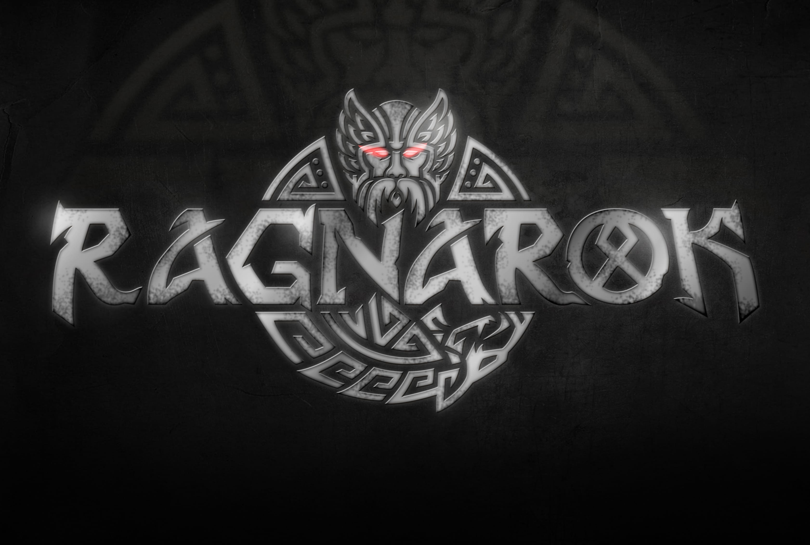

# Ragnarok: Norse Mythos Card Game

<p align="center">
  
</p>

A strategic card game combining a 7×5 chess board, Texas Hold’em combat, and mythological armies. Bet HP when pieces clash. Play against AI, explore the campaign, or challenge another player.

## Status

**Phase 1: Gameplay Validation** (`local-gameplay-v1`). Progression uses local replay and IndexedDB. P2P is gameplay-only; Hive settlement, marketplace, packs, NFTLox writes, and official ranking remain gated.

See the [readiness plan](docs/TESTNET_READINESS_FAST_TRACK.md) for release gates and pending validation.

## Quick Start

Requires **Node.js 24.x**, **pnpm 11.22.0**, Git, and a modern browser with WebAssembly. On Windows, use **WSL2/Ubuntu**; scripts require Bash.

```bash
npm install --global pnpm@11.22.0
git clone https://github.com/enrique89ve/ragnarok.git norse-mythos-card-game
cd norse-mythos-card-game
pnpm install --frozen-lockfile
```

Create a root `.env` with these values, preserving any existing configuration:

```dotenv
VITE_NETWORK_STAGE=local
ENABLE_CHAIN_INDEXER=false
PORT=5000
```

Leave `DATABASE_URL` unset for local play; `.env.example` includes a PostgreSQL placeholder.

```bash
pnpm run build:wasm
pnpm run dev:local
```

Open [localhost:5000](http://localhost:5000), choose **Single**, and prepare your Warband. Local Single requires no Hive account, Keychain, or PostgreSQL. Phones require landscape orientation.

Progress is stored in the browser and does not transfer with the repository. Rebuild WASM after changes to `assembly/`.

## Development

| Command | Purpose |
| --- | --- |
| `pnpm run dev:local` | Local development with guest Single |
| `pnpm run dev:alfa-testnet` | Alfa profile with Hive/Keychain |
| `pnpm run dev:testnet` | Generic QA profile using `.env.testnet` |
| `pnpm run check` | TypeScript validation |
| `pnpm run lint` | ESLint |
| `pnpm run test` | Vitest suite |
| `pnpm run build` | Build frontend and server after compiling WASM |
| `pnpm run start` | Serve the production build |

Configure shared test environments through the [testnet runbook](docs/TESTNET_RUNBOOK.md). Guest Single is available in local development.

**Stack:** React 19, TypeScript, Vite, Tailwind CSS, Zustand, Express, and AssemblyScript/WASM, with Hive integration behind phase gates.

## Documentation

- [Game rules](docs/RULEBOOK.md)
- [Network phases and capabilities](docs/PROTOCOL_CAPABILITY_MATRIX.md)
- [Hive protocol](docs/RAGNAROK_PROTOCOL_V1.md)
- [Environment security](docs/ENV_SECURITY.md)
- [Dokploy deployment](docs/DOKPLOY_DEPLOYMENT.md)
- [Architecture and conventions](CLAUDE.md)

## License

[MIT](LICENSE).
